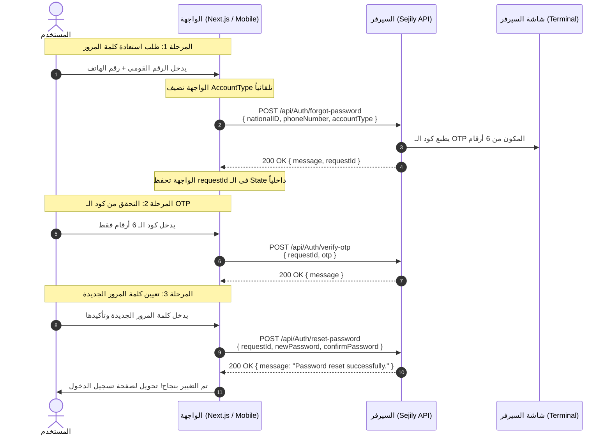

# دليل تكامل الـ Authentication للـ Frontend (Sejily API)
> **تاريخ التوثيق:** أكتوبر 2026  
> **الإصدار المستهدف:** Sejily ASP.NET Core 9.0 Web API  
> **الجمهور المستهدف:** مهندسو الواجهة الأمامية (Frontend Developers) — تطبيق الويب للأطباء (Next.js) وتطبيق الموبايل للمرضى.

---

## 1. نظرة عامة على المشروع (Project Overview)

منصة **سجلي (Sejily)** هي نظام رعاية صحية رقمي متكامل يخدم طرفين أساسيين من خلال تجربتي مستخدم منفصلتين تماماً:
1. **تطبيق الويب للأطباء (Doctor Web Application):** مبني باستخدام **Next.js**، مخصص للأطباء لإدارة المرضى والعيادات والسجلات الطبية.
2. **تطبيق الموبايل للمرضى (Patient Mobile Application):** مخصص للمرضى لإدارة بياناتهم الصحية والتابعين لهم وتاريخهم الطبي.

الـ Backend مبني بـ:
- **ASP.NET Core Web API (.NET 9)**
- **Entity Framework Core (SQL Server)**
- **ASP.NET Core Identity** لإدارة الحسابات وكلمات المرور وتشفيرها.
- **JWT (JSON Web Tokens)** لتأمين الـ Endpoints وإدارة الـ Sessions.
- **Swagger / OpenAPI** لتوثيق وتجربة الـ APIs محلياً.

> [!IMPORTANT]
> **قاعدة فصل الحسابات في قاعدة البيانات:**  
> جدول المستخدمين يحتوي على قيد فريد مركب `Unique Index` على: `(NationalID, AccountType)`.  
> هذا يعني أن نفس الرقم القومي (National ID) يمكن أن يمتلك **حسابين منفصلين تماماً**: حساب طبيب وحساب مريض، ولكل منهما كلمة مرور وبيانات وصلاحيات مستقلة تماماً. لا يتم دمج الحسابين على الإطلاق.

---

## 2. مسؤوليات الـ Backend والـ Frontend (Responsibilities)

| الجانب | مسؤوليات الـ Backend | مسؤوليات الـ Frontend (Next.js / Mobile) |
| :--- | :--- | :--- |
| **تحديد نوع الحساب (AccountType)** | التحقق الأمني وفرض السياسات (Policies) وحماية الـ Endpoints. | **التعيين التلقائي بنسبة 100%:** تحديد النوع حسب المنصة دون عرضه إطلاقاً على المستخدم (الويب يرسل `Doctor` والموبايل يرسل `Patient`). |
| **التحقق من المدخلات (Validation)** | فرض قواعد صارمة على طول الحقول، صيغة الرقم القومي (14 رقم)، الهاتف المصري، قوة كلمة المرور، وفحص التكرار في قاعدة البيانات. | التحقق الفوري في الواجهة (Client-side validation) لتحسين تجربة المستخدم ومنع إرسال طلبات غير صالحة، مع عرض رسائل واضحة ومفهومة. |
| **إدارة الجلسات (Sessions & Auth)** | توليد وتوقيع توكن الـ JWT مع إضافة الـ Claims المطلوبة وفترة الصلاحية (ساعة واحدة). | حفظ الـ JWT بشكل آمن (HTTP-only Cookies في Next.js أو Secure Storage في الموبايل)، وإرفاقه في كل طلب محمي، وحذفه بالكامل عند تسجيل الخروج. |
| **استعادة كلمة المرور (Forgot Password)** | توليد الـ OTP المشفر وتتبعه عبر `RequestId`، وفرض فترة سماح (Cooldown = 60 ثانية) وحد أقصى للمحاولات (5 محاولات). | الاحتفاظ بـ `RequestId` داخلياً في الـ State/Memory طوال الخطوات الثلاث دون إظهاره للمستخدم، وإرساله تلقائياً في طلبات التحقق وإعادة التعيين. |
| **إرسال الـ OTP في بيئة التطوير** | طباعة الرمز داخل شاشة الـ Terminal (Console) الخاصة بالـ Backend عبر `ConsoleOtpSmsSender`. | أخذ الكود من شاشة الـ Terminal الخاصة بالـ Backend أثناء التيست، حيث لا يتم إرسال SMS حقيقية حالياً. |

---

## 3. إعدادات الـ Base URL والربط عبر ngrok (API Base URL Configuration)

الـ API يعمل محلياً على المنافذ (Ports) التالية حسب ملف `launchSettings.json`:
- `https://localhost:7083`
- `http://localhost:5170`

أثناء التطوير وربط الموبايل أو الويب من أجهزة أخرى، يتم فتح نفق آمن باستخدام **ngrok**:
```bash
ngrok http https://localhost:7083
```
ينتج عن ذلك رابط خارجي مثل:
`https://YOUR-NGROK-URL` (مثال: `https://a1b2-c3d4.ngrok-free.app`).

### إعداد الرابط في Next.js (Doctor Web App)
يجب تجنب كتابة الرابط بشكل ثابت (Hardcoded) داخل الكود نهائياً. استخدم ملفات البيئة `.env.local`:

```env
# .env.local
NEXT_PUBLIC_API_BASE_URL=https://YOUR-NGROK-URL
```

إنشاء Axios/Fetch Client موحد:
```typescript
// lib/apiClient.ts
import axios from 'axios';

export const apiClient = axios.create({
  baseURL: process.env.NEXT_PUBLIC_API_BASE_URL || 'https://localhost:7083',
  headers: {
    'Content-Type': 'application/json',
    // مهم جداً إذا كنت تستخدم الحساب المجاني لـ ngrok لتخطي صفحة التحذير:
    'ngrok-skip-browser-warning': 'true',
  },
});
```

### ملاحظة حرجة بخصوص CORS في Next.js:
> [!WARNING]
> الـ Backend حالياً **لا يحتوي على إعدادات CORS مفعلة** في ملف `Program.cs`.  
> إذا حاول متصفح الويب (Client Component) إرسال طلب مباشر من `http://localhost:3000` إلى رابط الـ API أو ngrok، فسيقوم المتصفح بحظر الطلب بسبب سياسة CORS!  
> **الحل الأمثل في Next.js:** استخدام ميزة الـ Rewrites أو Route Handlers ليعمل Next.js كـ BFF (Backend For Frontend):
> ```javascript
> // next.config.mjs
> const nextConfig = {
>   async rewrites() {
>     return [
>       {
>         source: '/api/backend/:path*',
>         destination: `${process.env.NEXT_PUBLIC_API_BASE_URL}/api/:path*`,
>       },
>     ];
>   },
> };
> export default nextConfig;
> ```
> وبذلك يطلب الـ Frontend مسار `/api/backend/Auth/...` ويقوم سيرفر Next.js بتمريره للسيرفر الخلفي بدون أي قيود CORS.

---

## 4. جدول ملخص الـ Authentication Endpoints

جميع الـ Endpoints التالية تقع تحت المسار الأساسي `/api/Auth` ولا تتطلب أي توكن مسبق (`Public / Anonymous`):

| الـ Endpoint | الطريقة (Method) | الغرض الأساسي | نوع الحساب المستهدف | Auth Header مطلوب؟ |
| :--- | :---: | :--- | :--- | :---: |
| `/api/Auth/register/patient` | `POST` | إنشاء حساب مريض جديد | مريض فقط (Patient) | لا |
| `/api/Auth/register/doctor` | `POST` | إنشاء حساب طبيب جديد مع أماكن عمله | طبيب فقط (Doctor) | لا |
| `/api/Auth/login/patient` | `POST` | تسجيل دخول المريض واستلام JWT | مريض فقط (Patient) | لا |
| `/api/Auth/login/doctor` | `POST` | تسجيل دخول الطبيب واستلام JWT | طبيب فقط (Doctor) | لا |
| `/api/Auth/forgot-password` | `POST` | المرحلة 1: طلب استعادة كلمة المرور وإرسال OTP | مريض أو طبيب (محدد بالـ Body) | لا |
| `/api/Auth/verify-otp` | `POST` | المرحلة 2: التحقق من كود الـ OTP | مرتبط بـ `RequestId` | لا |
| `/api/Auth/resend-otp` | `POST` | إعادة إرسال OTP جديد لنفس الجلسة | مرتبط بـ `RequestId` | لا |
| `/api/Auth/reset-password` | `POST` | المرحلة 3: تعيين كلمة المرور الجديدة | مرتبط بـ `RequestId` | لا |

---

## 5. تسجيل ودخول الأطباء (Doctor Registration and Login)

تطبيق ويب الأطباء (Next.js) يتعامل حصرياً مع الـ Endpoints المخصصة للدكاترة.

### 5.1 تسجيل طبيب جديد (Register Doctor)
- **المسار:** `POST /api/Auth/register/doctor`
- **الغرض:** تسجيل حساب دكتور وربطه بمكان عمل طبي واحد على الأقل.
- **ملاحظات الـ Backend:**
  - يتم التحقق من عدم وجود طبيب آخر مسجل بنفس الرقم القومي `NationalID`.
  - يتم حفظ الطبيب بحالة غير مؤكدة أولياً (`IsVerified = false`).
  - يتم إنشاء اسم مستخدم داخلي بالصيغة: `{NationalID}_Doctor`.

#### حقول الطلب (RegisterDoctorRequest):
| الحقل (Field) | النوع | إلزامي؟ | الشروط والقيود |
| :--- | :--- | :---: | :--- |
| `nationalID` | string | نعم | 14 رقماً قومياً |
| `fullName` | string | نعم | الاسم الكامل (حد أقصى 200 حرف) |
| `address` | string | نعم | العنوان بالتفصيل (حد أقصى 500 حرف) |
| `dateOfBirth` | string (ISO Date) | نعم | مثال: `"1985-07-12T00:00:00Z"` أو `"1985-07-12"` |
| `phoneNumber` | string | نعم | رقم الموبايل المصري |
| `password` | string | نعم | من 8 إلى 100 حرف، يتطلب حرفاً كبيراً وصغيراً ورقماً ورمزاً خاصاً |
| `confirmPassword` | string | نعم | يجب أن يطابق `password` تماماً |
| `syndicateCardNumber` | string | نعم | رقم كارنيه النقابة (فريد ولا يتكرر) |
| `medicalLicenseNumber` | string | نعم | رقم ترخيص مزاولة المهنة (فريد ولا يتكرر) |
| `specialization` | string | نعم | التخصص الطبي (مثال: `"Cardiology"`) |
| `workPlaces` | Array of Objects | نعم | مصفوفة تحتوي على مكان عمل واحد على الأقل (`MinLength(1)`) |

**مواصفات عنصر مكان العمل (MedicalWorkPlace):**
- `type` (string enum): نوع المنشأة الطبية. القيم المسموحة نصياً:
  - `"GovernmentHospital"` (مستشفى حكومي)
  - `"PrivateHospital"` (مستشفى خاص)
  - `"PrivateClinic"` (عيادة خاصة)
  - `"MedicalCenter"` (مركز طبي)
  - `"RadiologyAndLaboratoryCenter"` (مركز أشعة وتحاليل)
- `name` (string): اسم المنشأة (من 3 إلى 200 حرف).
- `address` (string): عنوان المنشأة (من 5 إلى 500 حرف).
- `licenseNumber` (string): رقم ترخيص المنشأة (من 3 إلى 100 حرف).

#### مثال JSON صالح (Request Example):
```json
{
  "nationalID": "29001011234567",
  "fullName": "د. أحمد محمود علي",
  "address": "شارع التحرير، الدقي، الجيزة",
  "dateOfBirth": "1985-07-12T00:00:00Z",
  "phoneNumber": "01012345678",
  "password": "Doctor@Secure2026",
  "confirmPassword": "Doctor@Secure2026",
  "syndicateCardNumber": "SYN-987654",
  "medicalLicenseNumber": "LIC-123456",
  "specialization": "Cardiology",
  "workPlaces": [
    {
      "type": "PrivateHospital",
      "name": "مستشفى السلام الدولي",
      "address": "كورنيش النيل، المعادي، القاهرة",
      "licenseNumber": "WPL-8899"
    }
  ]
}
```

#### الاستجابة المتوقعة عند النجاح (200 OK):
```json
{
  "message": "Doctor registered successfully.",
  "userId": 5,
  "doctor": {
    "syndicateCardNumber": "SYN-987654",
    "medicalLicenseNumber": "LIC-123456",
    "specialization": "Cardiology",
    "isVerified": false
  },
  "workplaces": [
    {
      "workplaceId": 12,
      "name": "مستشفى السلام الدولي",
      "address": "كورنيش النيل، المعادي، القاهرة",
      "licenseNumber": "WPL-8899",
      "type": "PrivateHospital",
      "verificationStatus": "Pending"
    }
  ]
}
```

---

### 5.2 تسجيل دخول الطبيب (Doctor Login)
- **المسار:** `POST /api/Auth/login/doctor`
- **الغرض:** التحقق من بيانات الطبيب وإصدار توكن JWT يحمل صلاحيات الطبيب.
- **ملاحظة هامة:** لا يتم إرسال `AccountType` في الـ Body؛ الـ Endpoint نفسه مخصص للدكاترة فقط ويبحث فقط عن مستخدم مسجل كـ `Doctor`.

#### حقول الطلب (LoginRequest):
```json
{
  "nationalID": "29001011234567",
  "password": "Doctor@Secure2026"
}
```

#### الاستجابة المتوقعة عند النجاح (200 OK):
```json
{
  "token": "eyJhbGciOiJIUzI1NiIsInR5cCI6IkpXVCJ9.eyJzdWIiOiI1IiwibmFtZWlkIjoiNSIsInVuaXF1ZV9uYW1lIjoiMjkwMDEwMTEyMzQ1NjdfRG9jdG9yIiwiQWNjb3VudFR5cGUiOiJEb2N0b3IiLCJleHAiOjE3MjkxOTk5OTl9..."
}
```

#### أخطاء تسجيل الدخول:
- **401 Unauthorized:** إذا كان الرقم القومي غير مسجل كطبيب أو كانت كلمة المرور غير صحيحة:
  ```
  "Invalid National ID or password."
  ```

---

## 6. تسجيل ودخول المرضى (Patient Registration and Login)

تطبيق الموبايل للمرضى يتعامل حصرياً مع الـ Endpoints المخصصة للمرضى.

### 6.1 تسجيل مريض جديد (Register Patient)
- **المسار:** `POST /api/Auth/register/patient`
- **الغرض:** إنشاء ملف شخصي لمريض جديد وتعيين فصيلة الدم ورقم البطاقة الصحية.
- **ملاحظات الـ Backend:**
  - يتم التحقق من عدم وجود حساب مريض مسجل مسبقاً بنفس الرقم القومي.
  - يتم تخزين اسم المستخدم بالصيغة: `{NationalID}_Patient`.

#### حقول الطلب (RegisterPatientRequest):
| الحقل (Field) | النوع | إلزامي؟ | الشروط والقيود |
| :--- | :--- | :---: | :--- |
| `nationalID` | string | نعم | 14 رقماً قومياً |
| `fullName` | string | نعم | الاسم الرباعي للمريض |
| `address` | string | نعم | محل الإقامة |
| `dateOfBirth` | string (ISO Date) | نعم | مثال: `"1998-03-25T00:00:00Z"` |
| `bloodType` | string enum | نعم | فصيلة الدم (القيم موضحة أدناه) |
| `phoneNumber` | string | نعم | رقم الموبايل المصري |
| `password` | string | نعم | 8 أحرف على الأقل |
| `confirmPassword` | string | نعم | يطابق كلمة المرور |
| `healthCardNumber` | string | نعم | رقم البطاقة الصحية للمريض (فريد) |

**فصائل الدم المدعومة (BloodType Enum):**
`"APositive"`, `"ANegative"`, `"BPositive"`, `"BNegative"`, `"ABPositive"`, `"ABNegative"`, `"OPositive"`, `"ONegative"`

#### مثال JSON صالح (Request Example):
```json
{
  "nationalID": "29803251234567",
  "fullName": "سارة محمد إبراهيم",
  "address": "مدينة نصر، الحي السابع، القاهرة",
  "dateOfBirth": "1998-03-25T00:00:00Z",
  "bloodType": "OPositive",
  "phoneNumber": "01198765432",
  "password": "Patient@Pass2026",
  "confirmPassword": "Patient@Pass2026",
  "healthCardNumber": "HC-99887766"
}
```

#### الاستجابة المتوقعة عند النجاح (200 OK):
```json
{
  "message": "Patient registered successfully.",
  "userId": 9
}
```

---

### 6.2 تسجيل دخول المريض (Patient Login)
- **المسار:** `POST /api/Auth/login/patient`
- **الغرض:** تسجيل دخول المريض والحصول على JWT خاص بحساب المريض.

#### حقول الطلب (LoginRequest):
```json
{
  "nationalID": "29803251234567",
  "password": "Patient@Pass2026"
}
```

#### الاستجابة المتوقعة عند النجاح (200 OK):
```json
{
  "token": "eyJhbGciOiJIUzI1NiIsInR5cCI6IkpXVCJ9.eyJzdWIiOiI5IiwibmFtZWlkIjoiOSIsInVuaXF1ZV9uYW1lIjoiMjk4MDMyNTEyMzQ1NjdfUGF0aWVudCIsIkFjY291bnRUeXBlIjoiUGF0aWVudCIsImV4cCI6MTcyOTE5OTk5OX0..."
}
```

---

## 7. التعامل مع توكن الـ JWT (JWT Handling)

عند تسجيل الدخول بنجاح، يُرجع السيرفر كائن يحتوي على التوكن: `{ "token": "..." }`.

### 7.1 تشريح التوكن (Token Claims)
التوكن الصادر يحتوي على بيانات مشفرة وموقعة:
- `nameid` (`ClaimTypes.NameIdentifier`): معرّف المستخدم `UserId` كرقم نصي.
- `unique_name` (`ClaimTypes.Name`): اسم المستخدم (`{NationalID}_Doctor` أو `{NationalID}_Patient`).
- `AccountType`: نوع الحساب (`"Doctor"` أو `"Patient"`).
- `exp`: وقت انتهاء الصلاحية (مضبوط في الـ Backend على **ساعة واحدة فقط** `DateTime.UtcNow.AddHours(1)`).

### 7.2 إرفاق التوكن بالطلبات المحمية (Authorization Header)
في أي استدعاء للـ APIs المحمية (مثل إدارة التابعين أو سجلات المرضى)، يجب إرسال التوكن في الـ Header كالتالي:
```http
Authorization: Bearer <YOUR_JWT_TOKEN>
```

مثال عملي باستخدام Axios Interceptor:
```typescript
apiClient.interceptors.request.use((config) => {
  const token = getStoredToken(); // قراءة التوكن المخزن
  if (token) {
    config.headers.Authorization = `Bearer ${token}`;
  }
  return config;
});
```

### 7.3 أفضل الممارسات لتخزين وحذف التوكن (Security Practices)

#### أ. في تطبيق Next.js (ويب الأطباء):
- **الأفضل أمنياً:** تخزين التوكن في **HTTP-only Cookie** عبر Next.js Server Action أو Route Handler لمنع الوصول إليه عبر ثغرات XSS تماماً.
- **تجنب:** تخزين التوكن في `localStorage` في بيئة الإنتاج الحقيقية.
- **عند تسجيل الخروج (Logout):** حذف الـ Cookie أو مسح التوكن من الـ State وتوجيه الطبيب فوراً إلى صفحة `/login`.

#### ب. في تطبيق الموبايل (مرضى):
- **الأفضل أمنياً:** استخدام وحدات التخزين المشفرة الخاصة بنظام التشغيل:
  - React Native: `expo-secure-store` أو `react-native-keychain`.
  - Flutter: `flutter_secure_storage`.
- **تجنب تماماً:** استخدام `AsyncStorage` العادي بدون تشفير لحفظ التوكن.
- **عند تسجيل الخروج:** مسح التوكن المشفر وتفريغ الـ Global State (Redux / Zustand) والعودة لصفحة البداية.

---

## 8. دورة استعادة كلمة المرور — خطوة بخطوة (Forgot Password Flow)

عملية استعادة كلمة المرور مقسمة إلى 3 مراحل واضحة:



### تفاصيل المرحلة 1: طلب الرمز (Forgot Password)
- **المسار:** `POST /api/Auth/forgot-password`
- **المدخلات من المستخدم:** الرقم القومي ورقم الموبايل فقط.
- **المدخلات من الفرونت:** يتم إدراج حقل `accountType` تلقائياً حسب المنصة:
  - ويب الأطباء يرسل: `"Doctor"`
  - تطبيق الموبايل يرسل: `"Patient"`

#### مثال الطلب (Request Example):
```json
{
  "nationalID": "29001011234567",
  "phoneNumber": "01012345678",
  "accountType": "Doctor"
}
```

#### السلوك الأمني للـ Backend:
> [!NOTE]
> لحماية خصوصية المستخدمين ومنع المخترقين من معرفة أرقام الهواتف المسجلة (Account Enumeration Prevention):  
> السيرفر سيرد **دائماً بـ 200 OK** ومعه `requestId` عشوائي حتى لو كان الحساب غير موجود أو الهاتف لا يطابق المسجل!  
> إذا كان الحساب غير صحيح، سيصل الفرونت `requestId` شكلي، وسيفشل التحقق في المرحلة التالية عند إدخال الكود.

#### الاستجابة (Success Response - 200 OK):
```json
{
  "message": "If the account exists and the phone number matches, a reset code will be sent.",
  "requestId": "4f9d863e-32b0-4dbb-b27b-586b6ee1b1c3"
}
```

**إجراء الفرونت إند:**  
حفظ قيمة `requestId` في الـ State (مثل React State أو Context) ونقل المستخدم إلى شاشة إدخال الـ OTP دون عرض المعرف للمستخدم.

---

## 9. التحقق من الـ OTP وإعادة الإرسال (Verify & Resend OTP)

### 9.1 التحقق من الـ OTP (Verify OTP)
- **المسار:** `POST /api/Auth/verify-otp`
- **تجربة المستخدم:** المستخدم يُدخل **كود الـ OTP فقط** (6 أرقام).
- **دور الفرونت:** يدمج الـ `requestId` المحفوظ مسبقاً مع الكود في الطلب.

#### حقول الطلب (VerifyOtpRequest):
```json
{
  "requestId": "4f9d863e-32b0-4dbb-b27b-586b6ee1b1c3",
  "otp": "481920"
}
```

#### قواعد الـ Backend للـ OTP:
1. **الصلاحية الزمنية:** الـ OTP صالح لمدة **5 دقائق فقط** من وقت إرساله (`OtpLifetimeMinutes = 5`).
2. **حد المحاولات الخاطئة:** حد أقصى **5 محاولات خاطئة** (`MaxOtpAttempts = 5`). عند تجاوزها يتم حرق الرمز (`OtpConsumed = true`) ويجب طلب كود جديد من البداية.
3. **الاستخدام لمرة واحدة:** بمجرد نجاح التحقق، يصبح الـ OTP مستهلكاً ولا يمكن التحقق منه مرة أخرى.
4. **نافذة تغيير كلمة المرور:** بعد التحقق بنجاح، يُمنح المستخدم **10 دقائق** لإكمال إدخال كلمة المرور الجديدة (`PasswordResetWindowMinutes = 10`).

#### الاستجابة عند النجاح (200 OK):
```json
{
  "message": "OTP verified successfully. You can now reset your password."
}
```

#### استجابة الفشل (400 Bad Request):
إذا كان الكود خطأ، منتهي الصلاحية، أو تجاوز المحاولات:
```
"Invalid or expired OTP."
```

---

### 9.2 إعادة إرسال الـ OTP (Resend OTP)
- **المسار:** `POST /api/Auth/resend-otp`
- **الهدف:** إرسال كود جديد إذا تأخر أو لم يصل للمستخدم.
- **الحقل المطلوب:** `requestId` فقط.

#### حقول الطلب (ResendOtpRequest):
```json
{
  "requestId": "4f9d863e-32b0-4dbb-b27b-586b6ee1b1c3"
}
```

#### السلوك الحقيقي في الـ Backend:
1. **فترة الهدوء (Cooldown):** الـ Backend يفرض انتظار **60 ثانية** على الأقل بين كل طلب إرسال والطلب التالي (`OtpResendCooldownSeconds = 60`).
2. **إذا تم الطلب قبل انتهاء الـ 60 ثانية:** سيرد السيرفر بكود **429 Too Many Requests**:
   ```json
   {
     "message": "Please wait before requesting another OTP."
   }
   ```
3. **الحفاظ على المعرّف:** السيرفر **يحتفظ بنفس الـ `requestId` الأصلي** ويحدث فقط الـ OTP ووقته؛ لا يتم توليد `requestId` جديد.

#### الاستجابة عند النجاح (200 OK):
```json
{
  "message": "A new OTP has been sent if delivery succeeded.",
  "requestId": "4f9d863e-32b0-4dbb-b27b-586b6ee1b1c3"
}
```

> [!TIP]
> **توجيه لتجربة المستخدم في الواجهة:**  
> بعد الانتقال لشاشة الـ OTP أو بعد الضغط على "إعادة الإرسال"، ابدأ عداداً تنازلياً مدته **60 ثانية بالضبط** على زر "إعادة الإرسال" وقم بتعطيله (Disable) حتى ينتهي العداد، لتجنب ظهور الخطأ 429 للمستخدم.

---

## 10. تعيين كلمة المرور الجديدة (Reset Password)

- **المسار:** `POST /api/Auth/reset-password`
- **تجربة المستخدم:** المستخدم يُدخل كلمة المرور الجديدة وتأكيدها فقط.
- **دور الفرونت:** يرسل كلمة المرور وتأكيدها مع الـ `requestId` الذي تم التحقق منه مسبقاً.

#### حقول الطلب (ResetPasswordRequest):
```json
{
  "requestId": "4f9d863e-32b0-4dbb-b27b-586b6ee1b1c3",
  "newPassword": "NewStrongPassword@2026",
  "confirmPassword": "NewStrongPassword@2026"
}
```

#### قواعد التحقق:
- يجب أن تتطابق كلمتا المرور (الفرونت إند يتحقق قبل الإرسال، والـ Backend يتحقق عبر `[Compare]`).
- كلمة المرور يجب أن تحقق شروط الأمان الخاصة بـ ASP.NET Core Identity (أرقام، أحرف كبيرة وصغيرة، رموز خاصة، 8 أحرف على الأقل).

#### الاستجابة عند النجاح (200 OK):
```json
{
  "message": "Password reset successfully."
}
```
عند استلام هذا الرد، يقوم الفرونت إند بمسح الـ `requestId` من الذاكرة وتوجيه المستخدم لشاشة تسجيل الدخول مع رسالة نجاح.

---

## 11. دورة حياة المعرفات (RequestId & Reset Token Lifecycle)

لتجنب أي التباس لدى مطوري الواجهة، يوضح الجدول التالي الفرق بين المعرفات الأربعة المستخدمة في المنظومة:

| المصطلح | طبيعته ومصدره | أين يظهر؟ | دوره وغرضه |
| :--- | :--- | :--- | :--- |
| **`RequestId`** | `Guid` فريد يولده الـ Backend في المرحلة الأولى (`forgot-password`). | يرجع للفرونت ويُخزن في الـ State/Memory. | **معرف جلسة الاستعادة:** يربط بين المراحل الثلاث (`verify-otp` و `resend-otp` و `reset-password`). |
| **`ResetToken`** | مفهوم أمني للتوكن المؤقت بعد التحقق. | **غير موجود خارجياً في الـ API الحالي.** | يتم توليده واستخدامه داخلياً فقط في السيرفر داخل الـ ResetPassword عبر ASP.NET Identity ولا يُرسل للفرونت. |
| **`Otp`** | كود رقمي من 6 أرقام يولده السيرفر ويُطبع في الـ Console حالياً. | يراه المستخدم في التيرمينال ويدخله يدوياً. | إثبات ملكية رقم الهاتف المرتبط بالحساب. |
| **`JWT`** | توكن التوثيق المشفر الناتج بعد تسجيل الدخول بنجاح. | يُرجع في استجابة الـ Login ويُخزن بأمان. | السماح باستدعاء الـ APIs المحمية كطبيب أو مريض. |

---

## 12. أمثلة كاملة للطلبات والاستجابات (Request & Response Examples)

### مثال 1: خطأ التحقق من البيانات (400 Bad Request - Validation Errors)
إذا أرسل الفرونت رقماً قومياً ليس 14 رقماً أو هاتفاً غير مصري:
```http
POST /api/Auth/forgot-password
Content-Type: application/json

{
  "nationalID": "123",
  "phoneNumber": "01000",
  "accountType": "Patient"
}
```
الرد (ProblemDetails):
```json
{
  "type": "https://tools.ietf.org/html/rfc9110#section-15.5.1",
  "title": "One or more validation errors occurred.",
  "status": 400,
  "errors": {
    "NationalID": [
      "National ID must contain exactly 14 digits."
    ],
    "PhoneNumber": [
      "Enter a valid Egyptian mobile number."
    ]
  }
}
```

### مثال 2: خطأ تكرار الرقم القومي عند التسجيل (400 Bad Request)
إذا كان الحساب مسجلاً مسبقاً بنفس نوع الحساب:
```http
HTTP/1.1 400 Bad Request
Content-Type: text/plain

A Patient account with this National ID already exists.
```

### مثال 3: فشل شروط كلمة المرور في Identity (400 Bad Request)
عند التسجيل بكلمة مرور ضعيفة:
```json
[
  {
    "code": "PasswordTooShort",
    "description": "Passwords must be at least 8 characters."
  },
  {
    "code": "PasswordRequiresNonAlphanumeric",
    "description": "Passwords must have at least one non alphanumeric character."
  }
]
```

### مثال 4: خطأ إعادة الإرسال قبل انتهاء الهدوء (429 Too Many Requests)
```json
{
  "message": "Please wait before requesting another OTP."
}
```

### مثال 5: خطأ في إرسال الـ SMS من السيرفر (503 Service Unavailable)
إذا واجه السيرفر مشكلة داخلية في خدمة إرسال الـ OTP:
```json
{
  "message": "Unable to send the reset code. Please try again later."
}
```

---

## 13. معالجة الأخطاء في الواجهة (Validation and Error Handling)

يجب على مهندس الـ Frontend التعامل مع استجابات الـ HTTP كالتالي:

1. **400 Bad Request:**
   - قد يأتي كـ `string` بسيط (مثل `"Invalid or expired OTP."`).
   - قد يأتي ككائن أخطاء `errors` من ASP.NET Core: استخرج أول رسالة خطأ واعرضها أسفل الحقل المناسب.
   - قد يأتي كمصفوفة أخطاء Identity: اعرض رسائل الـ `description` للمستخدم ليعرف سبب رفض كلمة المرور.

2. **401 Unauthorized:**
   - في تسجيل الدخول: اعرض رسالة `"الرقم القومي أو كلمة المرور غير صحيحة"`.
   - في الـ Endpoints المحمية: يعني انتهاء صلاحية الـ JWT (بعد ساعة واحدة). يجب مسح التوكن المخزن فوراً وتوجيه المستخدم لصفحة تسجيل الدخول.

3. **403 Forbidden:**
   - يعني أن التوكن سليم، لكن الحساب يحاول الوصول لمورد غير مصرح له به (مثلاً توكن دكتور يحاول استدعاء مسار خاص بالمرضى `PatientOnly`).

4. **429 Too Many Requests:**
   - يظهر عند الضغط المتكرر على Resend OTP. أظهر رسالة: `"يرجى الانتظار دقيقة قبل طلب كود جديد"`.

5. **503 Service Unavailable:**
   - يظهر إذا تعطلت خدمة الإرسال. أظهر رسالة: `"تعذر إرسال الرمز حالياً، يرجى المحاولة لاحقاً"`.

---

## 14. دليل اختبار الـ APIs عبر Swagger (Swagger Testing Guide)

يمكن لمطوري الفرونت إند تجربة جميع الـ Endpoints والتأكد من استجاباتها عبر واجهة Swagger المدمجة:

1. شغل الـ Backend وتوجه إلى:  
   `https://localhost:7083/swagger` أو `http://localhost:5170/swagger`
2. **اختبار تسجيل الدخول:**
   - افتح مسار `POST /api/Auth/login/doctor` أو `POST /api/Auth/login/patient`.
   - اضغط **Try it out** وادخل بيانات الحساب.
   - اضغط **Execute** وانسخ قيمة الـ `token` من الـ Response.
3. **توثيق التوكن في Swagger:**
   - اضغط على زر **Authorize** (الموجود أعلى يمين الصفحة وعليه أيقونة قفل).
   - في خانة القيمة، الصق التوكن **مباشرة بدون كتابة كلمة Bearer** (تم ضبط السواجر ليضيف Bearer تلقائياً).
   - اضغط **Authorize** ثم **Close**.
4. الآن يمكنك اختبار أي Endpoint محمي والحصول على بيانات حقيقية.

---

## 15. الفروقات بين التصميم والتنفيذ الفعلي (Backend/Frontend Contract Gaps)

تم إجراء فحص دقيق لكود الـ Backend، ويجب على مهندسي الواجهة الانتباه للفروقات الهامة التالية بين التصميم النظري والتنفيذ الفعلي الحالي:

### 1. الـ ResetToken غير مُرسل ومستبدل بالـ RequestId:
- **التصميم المتوقع نظرياً:** أن يُرجع `POST /api/Auth/verify-otp` توكناً مؤقتاً مستقلاً (`resetToken`)، ويقوم الفرونت بإرساله في `POST /api/Auth/reset-password`.
- **الواقع الفعلي في الكود:**
  - الـ Endpoint الخاص بـ `verify-otp` **لا يرجع أي توكن على الإطلاق**؛ يرجع فقط رسالة نجاح:  
    `{ "message": "OTP verified successfully. You can now reset your password." }`.
  - الـ DTO الخاص بـ `ResetPasswordRequest` يطلب `requestId` فقط ولا يطلب أي `resetToken`.
  - يقوم السيرفر داخلياً بتوليد توكن Identity واستخدامه في نفس اللحظة دون إخراجه للفرونت.
- **تأثير ذلك على الفرونت:**  
  لا تنتظر ولا تبحث عن `resetToken`. استمر في استخدام نفس الـ `requestId` الذي استلمته في المرحلة الأولى ومرره في طلب تعيين كلمة المرور (`reset-password`).

### 2. غياب إعدادات CORS في الـ Backend:
- **الواقع الفعلي في الكود:** ملف `Program.cs` يخلو تماماً من `builder.Services.AddCors()` أو `app.UseCors()`.
- **تأثير ذلك على الفرونت (Next.js):**  
  أي استدعاء مباشر من المتصفح (Browser Client Components) لسيرفر الـ API سيفشل بسبب حظر المتصفح.  
  **الإجراء المطلوب:** يجب على مطوري Next.js توجيه الطلبات عبر الـ Next.js Server (BFF) باستخدام Rewrites أو Server Actions، حتى يتم إضافة CORS في الـ Backend.

### 3. مفتاح تشفير الـ OTP (`Otp:HashKey`):
- **الواقع الفعلي في الكود:** الدالة `HashSecret` في `AuthController` تعتمد على الإعداد `_configuration["Otp:HashKey"]`. هذا المتغير غير مكتوب في ملف `appsettings.json`.
- **تأثير ذلك على الفرونت:**  
  إذا تم تشغيل السيرفر بدون ضبط هذا المفتاح في الـ User Secrets أو متغيرات البيئة، ستفشل أي محاولة استعادة كلمة مرور بكود `503 Service Unavailable`. إذا ظهرت لك هذه المشكلة، أبلغ مهندس الـ Backend فوراً ليتأكد من ضبط `Otp:HashKey`.

### 4. طريقة تسليم الـ OTP خلال التطوير:
- **الواقع الفعلي في الكود:** خدمة `ConsoleOtpSmsSender` هي المفعلة حالياً في `Program.cs`، بينما كود `SmsMisr` معلق (Commented out) ولا يوجد أي تكامل مع Firebase.
- **تأثير ذلك على الفرونت:**  
  لن تصلك رسائل SMS على الموبايل أثناء التيست. الـ OTP يُطبع مباشرة في شاشة الـ Terminal الخاصة بالـ Backend.

---

## 16. قائمة التحقق لمهندس الواجهة (Integration Checklist)

قبل تسليم أو إطلاق ميزة الـ Authentication، تأكد من مطابقة النقاط التالية:

- [ ] **التعيين التلقائي لـ `AccountType`:** تم التحقق من أن المستخدم لا يختار نوع الحساب يدوياً، وأن تطبيق الويب يرسل `Doctor` وتطبيق الموبايل يرسل `Patient`.
- [ ] **عزل الحسابات:** التطبيق لا يفترض أن نفس الرقم القومي يدمج حساب الطبيب والمريض.
- [ ] **التحقق من المدخلات (Client-side):**
  - [ ] الرقم القومي مكون من 14 رقماً بالضبط.
  - [ ] رقم الهاتف يتبع نسق أرقام الموبايل المصرية (`010`, `011`, `012`, `015`).
  - [ ] كلمة المرور تحقق شروط القوة وتتطابق مع حقل التأكيد.
- [ ] **تخزين الـ JWT بأمان:**
  - [ ] تطبيق Next.js يخزن التوكن في HTTP-only Cookie أو عبر Server Session.
  - [ ] تطبيق الموبايل يستخدم `SecureStore` أو `Keychain`.
- [ ] **إرفاق التوكن:** تم إعداد Axios / Fetch Interceptor لإرفاق `Authorization: Bearer <token>` في الطلبات المحمية.
- [ ] **التعامل مع انتهاء الجلسة (401):** يتم تحويل المستخدم لصفحة تسجيل الدخول ومسح البيانات القديمة فور استلام 401.
- [ ] **مسار استعادة كلمة المرور:**
  - [ ] يتم حفظ `requestId` في الذاكرة دون عرضه لليوزر.
  - [ ] شاشة الـ OTP تطلب الرمز فقط وتمرر `requestId` في الخلفية.
  - [ ] تم تفعيل عداد تنازلي مدته 60 ثانية لزر "إعادة الإرسال" لتجنب خطأ 429.
  - [ ] شاشة تعيين كلمة المرور ترسل كلمة المرور الجديدة وتأكيدها والـ `requestId`.
  - [ ] يتم تفريغ `requestId` تماماً بعد نجاح العملية.
